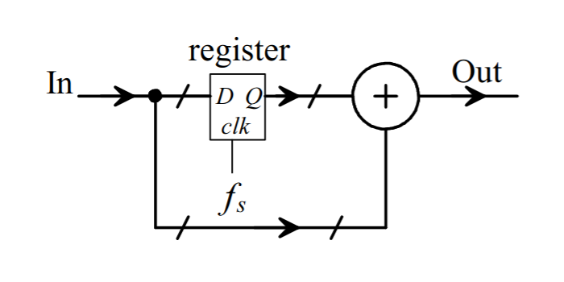
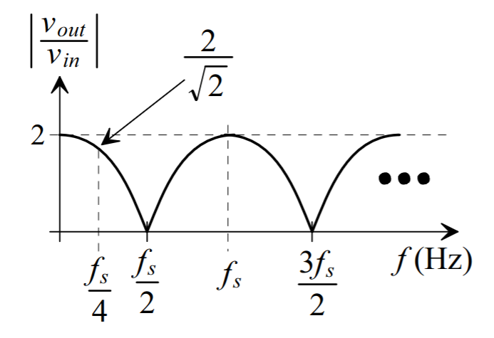
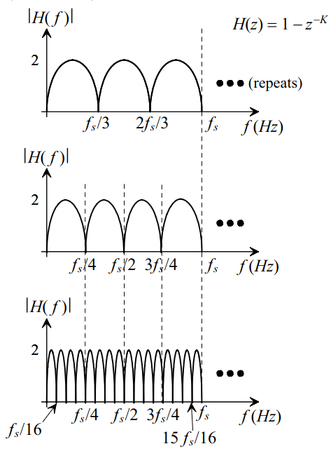

<!---

This file is used to generate your project datasheet. Please fill in the information below and delete any unused
sections.

You can also include images in this folder and reference them in the markdown. Each image must be less than
512 kb in size, and the combined size of all images must be less than 1 MB.
-->

## How it works

Comb filters are a very simple type of system that rejects the signals getting near or exact at half of the sampling frequency of the system. 

*Comb filter block diagram, taken from [1]*

It works by adding a delayed version of a sample to the current sample. In that way, once the frequency of the input signal or data starts approaching to the sampling frequency of the filter (dictated by how often the ADC delivers data or samples), destructive interference (and hence, "rejection" or simply nulling) occurs due the almost identical magnitude but different sign of the addition between previous and current sample. 

*Magnitude response of a comb filter, taken from [1]*

Furthermore, to implement this behavior, it was necessary to add data manipulation into the filter, because the ADC only works from 0V up to 3.3V, so there is no way by defect to gather negative samples. To fix this, a data centering was applied so every sample was moved into a mean reference value. For example, samples between 0V and 1.65V are considered negative and, by consequence, samples between 1.65V and 3.3V are considered as postive. Finally, it's worth to mention the reconfigurable behavior of this design, by the value programmed in the board for system clock and how the SPI master module derive the SCLK frequency based on it. Consider that every 16 SCLK cycles, the ADC will deliver a new sample, so it will 16 times the period of system clock and that becomes the value of sampling frequency.

Some technical specs:
1. SPI interface for ADC was designed for PMOD AD1.
2. SPI interface for DAC was designed for PMOD DA3.
3. ADC delivers 12 bit of data, so the datapath is up to 12 bits just before addition. After addition, it becomes 13 bits wide, so it can accomodate overflow in worst case. DAC still handles this, since it can work up to 16 bits.
4. SCLK should be greater than 1 MHz, otherwise the track and hold capacitance of PMOD AD1 may fail.
5. SCLK should not exceed 20 MHz.

Further work:
1. Explore feedback topolgy of comb filters.
2. Add more than 1 delay stage (i.e. register) in the datapath, so more nulls or spikes can happen before the Nyquist frequency (i.e. sampling frequency) and alias effect is avoided.

*Effect of adding more delays to a feedforward comb filter design, taken from [1]*

References:

- [1] 2nd Edition: R. J. Baker, CMOS Mixed-Signal Circuit Design, 2nd ed. Piscataway, NJ, USA: IEEE Press / John Wiley & Sons, 2009
Baker
- [2] Dr.-Ing Montero-Rodriguez, J-J, Diseño de Circuitos Integrados en Señal Mixta, Maestría en Electrónica, Escuela de Ingeniería Electrónica. Instituto Tecnológico de Costa Rica, 2025.

## How to test

Configure a system clock value and calculate in advance what would be the sampling frequency of the system. For example, with a 5 MHz system clock, SCLK would be 2.5MHz (it takes two cycles of system clock to generate SCLK, one for positive edge and the other for negative edge). Considering that every 16 SCLK cycles there is a new sample + the overhead for guard cycles and transfer data between FSM and filter datapath (more details below), sampling frequency would be 121.95 kHz. Based on comb filter theory, the first null (and the only acchievable, due alias effect) happens at half of the sampling frequency, which means roughly 60.5 MHz null frequency. In other words, if you configure a sine tone of 60.5MHz you will see how the output is a DC value at VDD/2, since spectral content has been removed completely. If you are approaching that value, you will notice how the amplitude decrease.

Simulation pictures ILA (check copyright)

In summary
$$
f_{sampling} = \frac{f_{sys\_clk}}{41}
$$

Where,

$$
41 = K + 1 + 1 + (2N + E) + H + 1 + 1
$$ 
$$
N = 16 \,\text{(SPI bits per AD1 transfer)}
$$ 
$$
E = 1 \,\text{(extra frame-end edge)}
$$ 
$$
H = 2 \,\text{(CS hold ticks)}
$$ 
$$
K = 2 \,\text{(FSM CS-high wait cycles)}
$$

If you are interested in how this was tested, please check this other repo I did <https://github.com/fabianpg3/comb_filter> with a UVM environment for functional verification and FPGA flow for emulation and testing on real hardware, using the PMODs + Nexys Video board.

Link to video
Pictures of setup

## External hardware

1. PMOD AD1.
2. PMOD DA3.
3. Frequency generator (for the input signal). Note: values should be between 0V and 3.3V, otherwise damage can happen with PMOD AD1 board.
4. Oscilloscope (for visualize the output signal).
5. Setup a system clock reference in the Tiny Tapeout board or provide a external clock signal from 1 MHz to 40MHz.

---

I want to express my gratitue to my family, thanks for always believe in me and push me out to keep learning and exploring new boundaries! Also, I want to say thanks to Instituto Tecnológico de Costa Rica, specially to the department of electronic engineering. It was really cool to apply the materials and experience learned by myself in mixed-signals course!